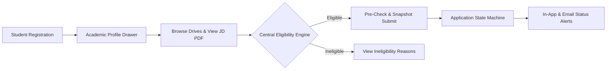
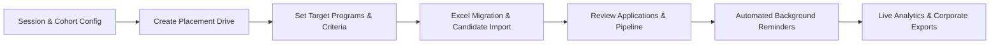

# CampusFlow V2 — Modern Collegiate Placement Management System

<p align="center">
  
  
  
  
  
  
</p>

CampusFlow V2 is an enterprise-grade placement management platform engineered to automate collegiate recruitment operations. Built with a high-performance **React + Vite** client and a scalable **Node.js + Express + MongoDB** backend, it manages academic cohorts, multi-criteria drive eligibility, immutable application snapshots, Excel migration preview/commit workflows, background deadline notifications, and live placement analytics.

---

## ⚡ Core Operational Workflows

### 1. Student Recruitment Journey


1. **Onboarding & Authentication:** Students authenticate with institutional email or University Seat Number (USN). New registrations start with a pristine, unentered profile.
2. **Academic Ledger:** Students record semester SGPAs (Semesters 1 to 8), Class 10/12/Diploma qualifications, backlogs, and resume links. Official CGPA is preserved without artificial averaging.
3. **Drive Discovery:** View upcoming and active placement drives, inspect attached Job Description (JD) PDFs, examine compensation packages, internship stipends, and work durations.
4. **Pre-Application Check & Snapshot:** The system verifies mandatory requirements in real time. Upon submission, an immutable `submittedSnapshot` is permanently sealed with the application.
5. **Real-time Notifications:** Receive in-app notifications and scheduled deadline reminders for upcoming drive closures.

---

### 2. TPO / Administrator Workflow


1. **Cohort & Session Management:** Define graduating sessions (e.g. 2025–26, 2026–27) with active/archived state lifecycles and degree duration rules.
2. **Drive Authoring & Program Targeting:** Author drives targeting specific programs from the approved 13-program academic catalogue, attach JD PDFs, specify paid/unpaid internship details, and configure reminder offsets.
3. **Excel Migration Hub:** Upload `.xlsx` spreadsheets for student records or academic histories with non-destructive dry-run previews, intra-spreadsheet duplicate checks, conflict detection, and atomic user rollbacks.
4. **Recruitment Pipeline:** Advance candidates through recruitment stages (`applied` → `shortlisted` → `interview` → `selected` / `rejected` / `withdrawn`) with complete transition history logging (`statusHistory`).
5. **Background Scheduler:** Automated MongoDB-backed worker polls every 60 seconds to dispatch urgent deadline reminders to eligible non-applicants.
6. **Analytics & Exports:** Real-time metrics tracking unique student placements per branch, salary distributions, recruitment funnels, and sanitized company exports with formula injection protection.

---

## 🚀 Key Feature Modules

### 🎓 1. Academic Ledger & Cohort Isolation
- **13 Approved Academic Programs:** Strict catalog resolution (`resolveStudentProgram`) preventing substring matching or unapproved program designations.
- **Preserved Official CGPA:** Official institutional CGPA is entered and verified independently from semester SGPAs; never overwritten by automatic math.
- **Independent Semester SGPA Ledger:** Dedicated slots for Semesters 1 through 8. Unrecorded semesters remain `Not entered` rather than coercing to zero.
- **Dynamic Qualifications:** Conditional inputs for Class 12 / PUC, Diploma, or Equivalent certifications.
- **Backlog & Gap Tracking:** Dedicated ledger for active and cleared backlogs, along with education gap declarations and duration justifications.

### 💼 2. Placement Drives & Program Targeting
- **Targeting Matrix:** Granular filtering matching candidate degree level, graduation year, and approved degree codes.
- **Attached Job Descriptions:** Direct cloud document links and local PDF file preview/download for official JDs.
- **Internship & Compensation Options:** Explicit fields for job type (`full-time`, `internship`, `internship-to-full-time`), internship classification (`paid`, `unpaid`), stipend values, and duration.
- **Custom Application Requirements:** TPO officers can toggle attribute requirements (`requiredToApply`, `visibleToTpo`, `shareWithCompany`) with privacy safeguards on family data.

### 🛡️ 3. Centralized Eligibility Engine
- **Multi-Criteria Evaluation:** Dynamic evaluation of CGPA cutoffs, maximum active backlogs, historical backlogs, 10th/12th percentages, and degree programs.
- **Transparency for Students:** Ineligible students can inspect all drives, with a detailed breakdown highlighting exactly why they are currently ineligible.
- **Immutable Application Snapshots:** Every submission freezes candidate credentials, preventing post-application profile updates from retroactively altering application records.
- **Authorized TPO Overrides:** TPOs can grant special eligibility exceptions, which are durably recorded with reasons and authenticated actor timestamps.

### 📊 4. Excel Migration Hub & Compliance Exports
- **Preview Before Commit:** Dry-run analysis generates detailed breakdowns of `VALID`, `WARNING`, `CONFLICT`, and `ERROR` rows without writing to the database.
- **Integrity Safeguards:** Intra-spreadsheet USN duplicate detection, conflict detection for verified records, and atomic rollback (`User.findByIdAndDelete`) if student profile creation fails.
- **Formula Injection Defense:** All spreadsheet exports sanitize cells beginning with `=`, `+`, `-`, `@`, `\t`, or `\r` by prepending `'`.
- **Durable Audit Logging:** Imports and exports are durably tracked in `ImportBatch` and `ExportLog` collections.

### ⏰ 5. Automated Background Reminders & Notifications
- **Persistent MongoDB Scheduler:** Background worker (`ReminderJob`) operates on a 60-second cycle without requiring extra Redis/BullMQ infrastructure.
- **Crash & Restart Recovery:** Job state machine (`PENDING` → `PROCESSING` → `COMPLETED` / `FAILED` / `CANCELLED`) with idempotency keys prevents duplicate notifications after server restarts.
- **Targeted Non-Applicant Reminders:** Automatically notifies only eligible students who have not yet submitted an application.
- **Truthful SMTP Diagnostics:** Real-time SMTP configuration checks (`isSmtpConfigured()`) ensure transparent delivery metrics without fabricating fake success.

### 📈 6. Live Placement Analytics
- **Unique Student Placement Count:** Branch placement metrics track unique placed students via sets, preventing multiple job offers from artificially inflating placement percentages.
- **Active Funnel Conversion:** Recruitment funnel stages exclude withdrawn applications from active pipeline counts.
- **Salary Tier Distribution:** Categorized brackets (`< 5 LPA`, `5 - 10 LPA`, `10 - 20 LPA`, `> 20 LPA`) with average and highest CTC calculations.
- **Session Scoping:** All analytics endpoints support optional session filtering to isolate graduating cohorts.

---

## 🛠️ Technology Stack

```text
Frontend Architecture
├── Core:             React 18, Vite 8, JavaScript (ESM)
├── State & Routing:  React Context API, React Router DOM (v7)
├── Styling & UI:     Tailwind CSS, Lucide React Icons
└── Networking:       Axios (with JWT auto-refresh interceptors), React Hot Toast

Backend Architecture
├── Runtime:          Node.js (v18+ LTS), Express.js (v5)
├── Database:         MongoDB with Mongoose ODM
├── Authentication:   JSON Web Tokens (JWT), Bcrypt password hashing
├── File Processing:  ExcelJS (streaming workbook generation), Multer (memory storage)
├── Cloud Services:   Cloudinary (resume & marksheet uploads), Nodemailer (RFC-compliant SMTP)
└── Testing:          Node.js Test Runner (native node --test TAP runner)
```

---

## 📂 Project Directory Structure

```text
campus_flow/
├── frontend/                                # React + Vite Single-Page Application
│   ├── public/                              # Static public assets
│   ├── src/
│   │   ├── components/
│   │   │   ├── admin/                       # TPO Admin Management Components
│   │   │   │   ├── AdminOverview.jsx        # High-level metrics and quick actions
│   │   │   │   ├── AdminSidebar.jsx         # Administrative navigation
│   │   │   │   ├── ExcelMigrationHub.jsx    # Excel preview, upload & commit hub
│   │   │   │   ├── ManageAnnouncements.jsx  # Broadcast composer & scheduled reminders
│   │   │   │   ├── ManageApplications.jsx   # Candidate pipeline & round transitions
│   │   │   │   ├── ManageDrives.jsx         # Drive authoring, JD upload & requirements
│   │   │   │   ├── ManageSessions.jsx       # Academic session & cohort isolation
│   │   │   │   ├── ManageStudents.jsx       # Student roster & verification controls
│   │   │   │   ├── PlacementAnalytics.jsx   # Branch charts, CTC tiers & recruiter ranks
│   │   │   │   └── StudentDetailModal.jsx   # Confidential dossier & SGPA ledger modal
│   │   │   ├── HomePageDashboard/           # Public landing page components
│   │   │   └── studentDashboard/            # Student Portal Components
│   │   │       ├── ApplyModal.jsx           # Pre-application requirements checklist
│   │   │       ├── ProfileDrawer.jsx        # Academic ledger, SGPAs, marks & resume
│   │   │       ├── RecentApplications.jsx   # Submitted application status tracker
│   │   │       ├── StudentNavbar.jsx        # In-app notification center & quick links
│   │   │       └── StudentSidebar.jsx       # Student portal navigation
│   │   ├── context/                         # AuthContext (JWT session & role state)
│   │   ├── pages/
│   │   │   ├── admin/AdminDashboard.jsx     # Consolidated TPO workspace
│   │   │   ├── auth/Login.jsx               # Login with demo quick-fill toggles
│   │   │   ├── auth/Signup.jsx              # Clean onboarding registration
│   │   │   └── student/StudentDashboard.jsx # Student dashboard workspace
│   │   └── services/                        # Modular Axios API services
│   │       ├── adminService.js              # Drive, student & company API endpoints
│   │       ├── api.js                       # Axios instance with 401 refresh logic
│   │       ├── apiConfig.js                 # Base URL configuration resolver
│   │       ├── authService.js               # Login, registration & department queries
│   │       ├── excelService.js              # Spreadsheet preview & commit API
│   │       ├── notificationService.js       # Broadcast, SMTP status & reminder calls
│   │       ├── sessionService.js            # Cohort session query & mutation API
│   │       └── studentService.js            # Profile, drives & application submission
│   └── package.json
│
└── major-backend/                           # Node.js + Express API Backend
    ├── src/
    │   ├── constants/
    │   │   └── programCatalog.js            # 13 approved academic degree programs
    │   ├── controllers/
    │   │   ├── admin.controller.js          # Admin auth & institutional controls
    │   │   ├── application.controller.js    # Application submission, rounds & snapshots
    │   │   ├── company.controller.js        # Recruiting partner directory
    │   │   ├── dashboard.controller.js      # Consolidated analytics & branch stats
    │   │   ├── department.controller.js     # Academic department records
    │   │   ├── notification.controller.js   # In-app notifications & SMTP diagnostics
    │   │   ├── placementDrive.controller.js # Drive authoring, requirements & JD files
    │   │   ├── placementSession.controller.js # Cohort lifecycle & default mapping
    │   │   ├── studentProfile.controller.js # Academic ledger, CGPA & dossier edits
    │   │   └── user.controller.js           # Student auth, tokens & USN lookups
    │   ├── db/
    │   │   └── index.js                     # Resilient MongoDB connection manager
    │   ├── middlewares/
    │   │   ├── auth.middleware.js           # JWT verification & role authorization
    │   │   └── multer.middleware.js         # In-memory multipart file parser
    │   ├── models/                          # Mongoose Data Models
    │   │   ├── admin.model.js               # TPO administrative accounts
    │   │   ├── application.model.js         # Applications, rounds & snapshots
    │   │   ├── company.model.js             # Partner corporate profiles
    │   │   ├── department.model.js          # Academic departments
    │   │   ├── exportLog.model.js           # Audit log for spreadsheet exports
    │   │   ├── importBatch.model.js         # Audit log for Excel imports
    │   │   ├── notification.model.js        # In-app alerts & reminders
    │   │   ├── placementDrive.model.js      # Placement drives, criteria & reminders
    │   │   ├── placementSession.model.js    # Academic sessions & year mappings
    │   │   ├── reminderJob.model.js         # Background scheduled jobs
    │   │   ├── studentProfile.model.js      # Comprehensive student academic profiles
    │   │   └── user.models.js               # Base user credentials & roles
    │   ├── routes/                          # Express Route Definitions
    │   ├── services/                        # Business Logic Services
    │   │   ├── eligibility.service.js       # Multi-criteria eligibility evaluator
    │   │   ├── excelImportExport.service.js # Excel parsing, preview, commit & export
    │   │   ├── programTargeting.service.js  # Degree & branch targeting matcher
    │   │   └── reminderScheduler.service.js # 60s persistent reminder worker
    │   ├── utils/                           # Handlers, responses & mail helpers
    │   └── app.js                           # Express app configuration & middleware
    ├── tests/                               # Automated Test Suites
    │   ├── config.test.js                   # Environment & security config tests
    │   ├── http.test.js                     # Health check & JSON 404 tests
    │   ├── programCatalog.test.js           # 13-program catalog validation
    │   ├── smtp_diagnostics_and_delivery.test.js # SMTP diagnostic & error tests
    │   └── notifications_reminders.test.js  # Background scheduler integration tests
    └── package.json
```

---

## ⚙️ Environment Configuration

### Backend Configuration (`major-backend/.env`)
Create a `.env` file in `major-backend/`. Use generic placeholders for local setup:

```env
# Server Configuration
PORT=8000
NODE_ENV=development
FRONTEND_URL=http://localhost:5173
CORS_ORIGIN=http://localhost:5173,http://localhost:3000

# Database Configuration (Set in major-backend/.env, see major-backend/.env.example)
MONGODB_URI=mongodb://127.0.0.1:27017

# JWT Authentication Secrets (Generate secure random 64-char strings)
ACCESS_TOKEN_SECRET=your_jwt_access_token_secret_key_minimum_64_characters
ACCESS_TOKEN_EXPIRY=1d
REFRESH_TOKEN_SECRET=your_jwt_refresh_token_secret_key_minimum_64_characters
REFRESH_TOKEN_EXPIRY=7d

# TPO Admin Provisioning Key
ADMIN_SECRET_KEY=your_tpo_admin_secret_passkey

# SMTP Email Configuration (Optional - for real email delivery)
EMAIL_HOST=smtp.gmail.com
EMAIL_PORT=587
EMAIL_USER=your_institutional_email@domain.edu
EMAIL_PASS=your_smtp_app_password
EMAIL_FROM="Training & Placement Cell" <your_institutional_email@domain.edu>

# Cloud Storage (Optional - for cloud resume uploads)
CLOUDINARY_CLOUD_NAME=your_cloudinary_cloud_name
CLOUDINARY_API_KEY=your_cloudinary_api_key
CLOUDINARY_API_SECRET=your_cloudinary_api_secret
```

### Frontend Configuration (`frontend/.env`)
Create a `.env` file in `frontend/`:

```env
# Backend API Base URL
VITE_API_URL=http://localhost:8000/api/v1
```

> **Security Note:** Never commit `.env` files or hardcode credentials into source control. All secrets are managed via environment variables.

---

## 🚦 Getting Started

### 1. Prerequisites
- **Node.js:** v18.0.0 or higher
- **npm:** v9.0.0 or higher
- **MongoDB:** Active MongoDB Atlas cluster or local MongoDB instance

### 2. Installation
```powershell
# Clone the repository
git clone https://github.com/laksh76777/campus_flow.git
cd campus_flow

# Install backend dependencies
cd major-backend
npm install

# Install frontend dependencies
cd ../frontend
npm install
```

### 3. Running Development Servers
Open two terminal windows:

```powershell
# Terminal 1 — Start Backend Server (runs on http://localhost:8000)
cd major-backend
npm run dev

# Terminal 2 — Start Frontend Client (runs on http://localhost:5173)
cd frontend
npm run dev
```

Visit [`http://localhost:5173`](http://localhost:5173) in your browser.

> [!CAUTION]
> **Database Safety:** Do not execute `node src/scripts/seedCleanState.js` on shared, staging, or production databases. It performs a complete, irreversible wipe of existing data before seeding.

---

## 🧪 Verification & Testing

CampusFlow V2 includes comprehensive automated tests covering configuration, authentication boundaries, program catalogs, Excel formula sanitization, and background reminder persistence:

```powershell
# Run backend test suite (25 native node:test unit & integration tests)
cd major-backend
npm test

# Run frontend lint verification (0 errors)
cd ../frontend
npm run lint

# Run frontend production build
npm run build
```

---

## 🔒 Security & Compliance Standards

- **Role-Based Access Control (RBAC):** Backend enforces strict route middlewares (`verifyJWT`, `verifyStudent`, `verifyAdmin`). Sensitive endpoints (e.g. administrative student dossiers) reject student tokens with HTTP 403.
- **Formula Injection Sanitization:** All spreadsheet exports automatically neutralize executable spreadsheet formulas (`=`, `+`, `-`, `@`) with prepended apostrophes.
- **Privacy By Default:** Family records (parents' names, occupations, residential addresses) are strictly excluded from company candidate exports unless explicitly authorized.
- **Immutable Application Snapshots:** Candidate academic data is immutably captured at the point of submission, preventing retroactive profile tampering.
- **Truthful Status Reporting:** When external services (such as SMTP mailers) are unconfigured, the system truthfully logs `SMTP_NOT_CONFIGURED` without falsifying delivery.

---

## 📄 License
This repository is developed for collegiate placement management and recruitment automation.
